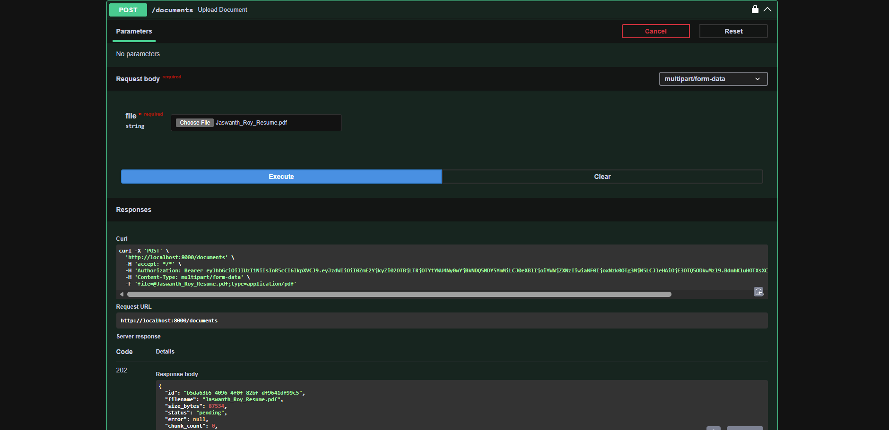
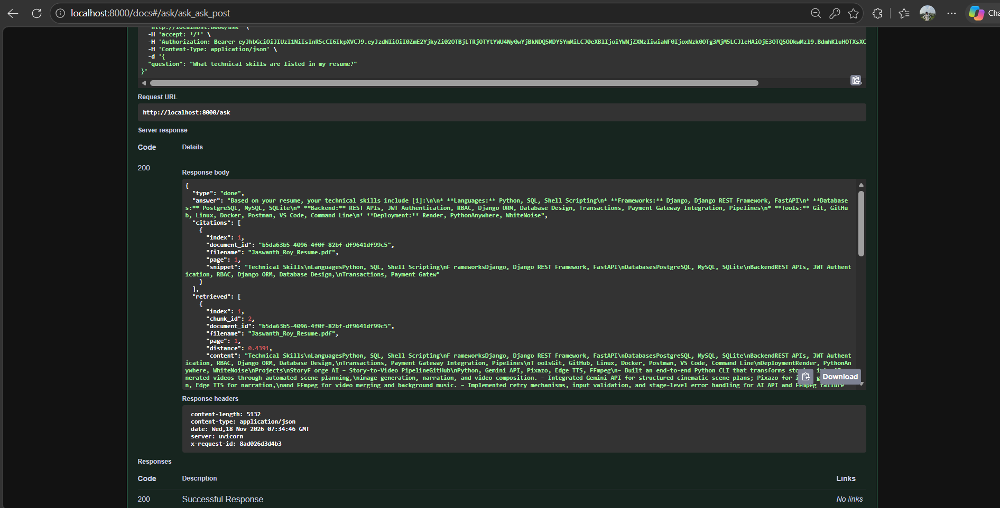
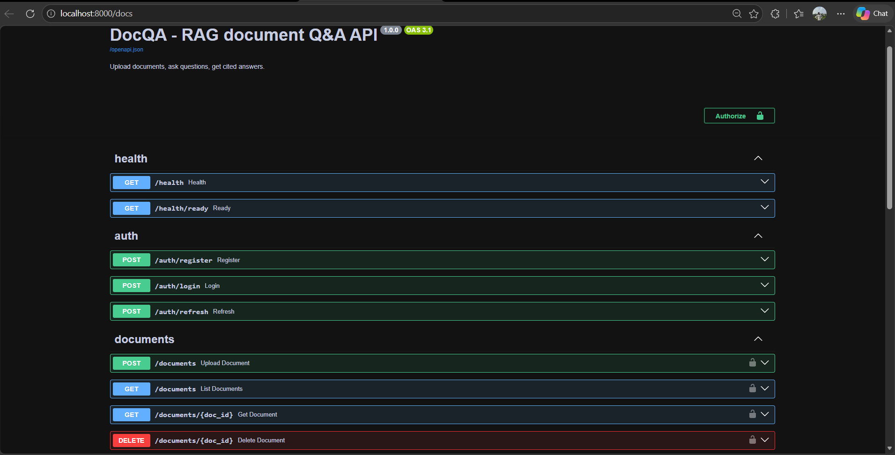
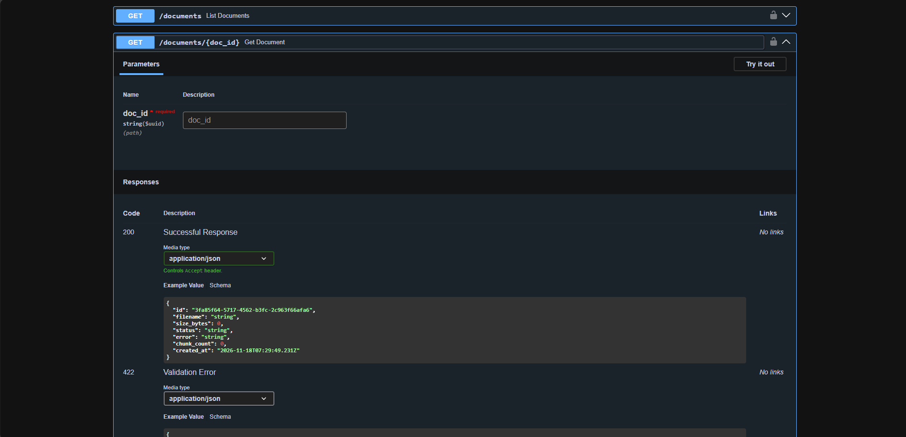
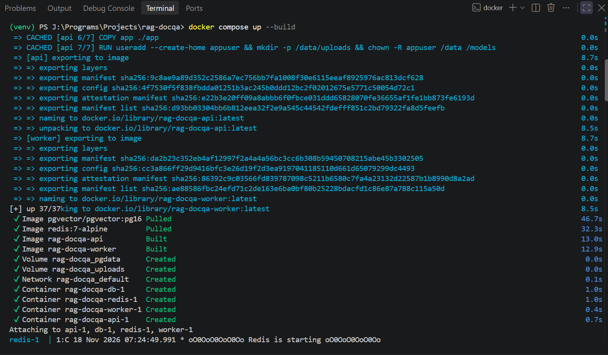

# DocQA: RAG document Q&A API

Upload PDFs, DOCX or text files, then ask questions. Answers come **only from your documents**, with
citations (file and page), streaming responses, and an explicit "I don't know" when the documents don't
contain the answer.

**Stack:** FastAPI, PostgreSQL + pgvector, Celery, Redis, JWT auth, Docker, GitHub Actions, pytest.
Embeddings run locally (free). The LLM is Claude through the Anthropic API, with a keyless mock mode.

## Demo

**Cited answer.** Every claim points to a file and page.


**Caching.** The repeated question returns in milliseconds.


<details>
<summary>More screenshots</summary>





</details>

## Architecture

```
                ┌────────────┐   enqueue    ┌─────────┐   consume   ┌────────────────────┐
 client ──JWT──▶│  FastAPI   │─────────────▶│  Redis  │────────────▶│   Celery worker    │
        ◀─SSE───│  (api)     │              │ (broker,│             │ extract → chunk →  │
                └─────┬──────┘              │  cache, │             │ embed → store      │
                      │                     │  limits)│             └─────────┬──────────┘
        ask: cache ◀──┤                     └─────────┘                       │
        → hybrid      │                                                       ▼
        retrieval ────┴──────────────▶ PostgreSQL + pgvector ◀────────────────┘
        → LLM (cited, streamed)        users · documents · chunks(vector + tsvector)
                                       conversations · messages · query_logs
```

**Ask flow:** rate limit → Redis cache → retrieval (pgvector cosine search + Postgres full-text search,
merged with Reciprocal Rank Fusion) → relevance gate (refuse without calling the LLM if nothing is close)
→ LLM with numbered sources → citations parsed from the answer → saved to history + `query_logs`.

## Quick start (Docker)

```bash
cp .env.example .env          # set SECRET_KEY; optionally LLM_PROVIDER=anthropic + ANTHROPIC_API_KEY
docker compose up --build     # api on http://localhost:8000, interactive docs at /docs
```

With `LLM_PROVIDER=mock` everything works without a key (answers are extractive, not generated), which is
handy for trying the pipeline. For real answers use one of:

- **Gemini (free tier):** create a key at https://aistudio.google.com, then in `.env` set `LLM_PROVIDER=gemini`
  and `GEMINI_API_KEY=...`. Free-tier requests may be used by Google to improve its products, so don't upload
  confidential documents. Limits and model names change; if you get a "model not found" error, set `LLM_MODEL`
  to a model listed in AI Studio.
- **Claude:** set `LLM_PROVIDER=anthropic` and `ANTHROPIC_API_KEY=...` (paid API key).

After editing `.env`, run `docker compose up --build -d` (a rebuild is needed once to install the new dependency).

```bash
# 1. register + login
curl -X POST localhost:8000/auth/register -H 'content-type: application/json' \
     -d '{"email":"me@example.com","password":"a-long-password"}'
TOKEN=$(curl -s -X POST localhost:8000/auth/login -d 'username=me@example.com&password=a-long-password' \
        | python3 -c "import sys,json;print(json.load(sys.stdin)['access_token'])")

# 2. upload (returns 202 immediately; poll GET /documents/{id} until status is "ready")
curl -X POST localhost:8000/documents -H "Authorization: Bearer $TOKEN" -F file=@eval/docs/acme_handbook.txt

# 3. ask (add "stream": true for Server-Sent Events)
curl -X POST localhost:8000/ask -H "Authorization: Bearer $TOKEN" -H 'content-type: application/json' \
     -d '{"question":"How many days of paid annual leave do employees get?"}'
```

## Running without Docker

```bash
python -m venv .venv && source .venv/bin/activate && pip install -r requirements-dev.txt
# needs Postgres with the pgvector extension and Redis running locally (see .env.example)
uvicorn app.main:app --reload                                  # terminal 1
celery -A app.workers.celery_app worker --loglevel=info        # terminal 2
```

## API

| Method | Path | Purpose |
|---|---|---|
| POST | `/auth/register`, `/auth/login`, `/auth/refresh` | Accounts and JWT access/refresh tokens |
| POST | `/documents` | Upload (202, processed in the background) |
| GET | `/documents`, `/documents/{id}` | List (paginated) / check processing status |
| DELETE | `/documents/{id}` | Delete file, chunks, and invalidate cached answers |
| POST | `/ask` | Ask a question. Options: `document_ids`, `conversation_id`, `stream`, `mode` (`hybrid`/`vector`/`keyword`), `top_k`, `no_cache` |
| GET | `/conversations`, `/conversations/{id}` | Chat history with citations |
| GET | `/usage` | Your query count, cache hit rate, latency, tokens, cost |
| GET | `/health`, `/health/ready` | Liveness / dependency readiness |

## Design decisions

- **Hybrid retrieval.** Vector search finds paraphrases; Postgres full-text search finds exact terms (IDs,
  names, numbers) that embeddings blur. Reciprocal Rank Fusion merges both without needing comparable scores.
  `mode` lets you compare them in the eval.
- **Refusal before the LLM.** If the closest chunk is farther than `MAX_VECTOR_DISTANCE`, the API answers
  "I don't know" without spending tokens. The prompt also instructs the model to refuse when sources are insufficient.
- **Per-user isolation at the query level.** `user_id` is stored on every chunk and every retrieval filters on
  it. Other users' documents return 404, not 403, so IDs can't be probed. Covered by tests.
- **Prompt-injection hygiene.** Sources are wrapped in tags, labelled as untrusted data in the system prompt,
  and a source can't close its own tag. This reduces risk; it can't eliminate it (see limitations).
- **Reliable ingestion.** Uploads return immediately; a Celery worker does the slow work with `acks_late`,
  retries for transient errors, and a `failed` status plus message for permanent ones (corrupt/scanned PDFs).
  Re-running a task replaces chunks instead of duplicating them. Identical re-uploads get 409 (SHA-256).
- **Cache correctness.** Keys include the user, normalised question, mode, top_k, and a per-user "corpus version"
  that is bumped on every upload/delete, so stale answers are never served after documents change.
- **Redis is optional at runtime.** Rate limiting and caching fail open if Redis is down; the API keeps working.
- **Streaming** uses Server-Sent Events; history and `query_logs` are written when the stream completes.

## Testing, evaluation, load testing

```bash
pytest -q                                     # runs against real Postgres+pgvector (CI uses a service container)
python eval/run_eval.py --top-k 3             # retrieval/answer/refusal quality per mode; server must be running
locust -f locustfile.py --host http://localhost:8000
```

The eval reports **hit@k**, **answer_ok** and **refusal_ok** for vector, keyword and hybrid modes and prints the
distance ranges for answerable vs unanswerable questions, which tells you what to set `MAX_VECTOR_DISTANCE` to.
The bundled sample corpus is tiny, so results saturate at high `--top-k`. **Add your own documents to
`eval/docs/` and 30+ questions to `eval/questions.jsonl` before trusting or quoting any number.**
Load-test and `/usage` numbers (cache hit rate, cached vs uncached latency) are the ones worth putting on a resume
once you've measured them on your own deployment.

## Deploying to AWS

1. **RDS PostgreSQL** (15+ supports `CREATE EXTENSION vector`), **ElastiCache or a Redis container**, **S3 bucket**.
2. On an **EC2** instance with an IAM role allowing S3 access to the bucket, run `docker compose up -d` with
   `STORAGE_BACKEND=s3`, `S3_BUCKET=...`, `DATABASE_URL`/`REDIS_URL` pointing at RDS/Redis, `ENVIRONMENT=production`,
   and a real `SECRET_KEY` (the app refuses to start in production with the default).
3. Put nginx or an ALB in front for HTTPS. Disable proxy buffering for `/ask` so streaming works (the app already
   sends `X-Accel-Buffering: no`). Remove the `db`/`redis` services from compose if you use managed ones.
4. Set a billing alert.

## Known limitations (and what to do about them)

- **Tables are created with `create_all`**, not migrations. Add Alembic before changing the schema in production.
- **No OCR.** Scanned PDFs are rejected with a clear error.
- **Each question is answered independently.** History is stored but not fed back to the LLM, which keeps caching
  correct. Follow-up questions ("and what about X?") need query rewriting to work well.
- **No reranker.** RRF is a strong baseline; a cross-encoder reranker is the natural next step.
- **`MAX_VECTOR_DISTANCE` must be tuned** for your embedding model; the default is a starting guess.
- **Prompt injection can't be fully prevented**, only mitigated. Don't give the LLM tools or secrets.
- **Fixed-window rate limiting** allows short bursts at window edges. A sliding window or token bucket is stricter.
- The hybrid relevance gate looks at vector distance only, so a query matching an exact rare keyword but nothing
  semantically can still be refused.

## Project layout

```
app/
  main.py                 app factory, JSON logging, request-id middleware
  models.py  schemas.py   tables / API models
  api/deps.py, routes/    auth, documents, ask (JSON + SSE), conversations/usage, health
  core/                   config, JWT + password hashing, Redis client, rate limiter
  services/               extract, chunking, embeddings, storage (local/S3), retrieval, llm, cache, qa
  workers/                Celery app + ingestion task
tests/                    unit + API/integration tests
eval/                     sample docs, questions, run_eval.py
locustfile.py  Dockerfile  docker-compose.yml  .github/workflows/ci.yml
```
